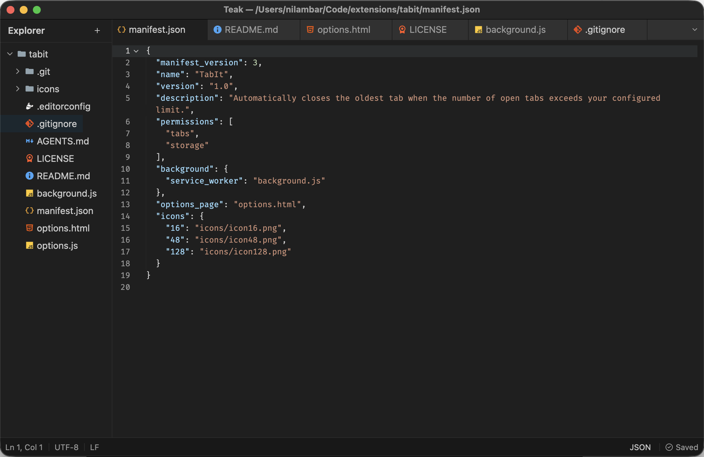

# Teak

A fast, lightweight text editor.

## Screenshot



## Features

- Tabs and syntax highlighting
- File explorer sidebar with git status marks
- Changed lines marked in the editor gutter while you type, before saving
- Git branch, with ahead/behind counts, in the status bar
- Watches open folders, so changes made by other programs show up on their own
- Command palette (`Cmd+Shift+P`)
- Quick Open (`Cmd+P`) to fuzzy-find files
- Find and Replace in Files (`Cmd+Shift+F`), with regex and globs
- Markdown preview (`Cmd+Shift+V`)
- Restores your tabs and folders on relaunch
- `teak` command to open files from the terminal
- Light, dark, and system themes

## Requirements

macOS 15 or later on Apple Silicon (M1 or newer).

## Install

Install with [Homebrew](https://brew.sh):

```sh
brew tap ernilambar/tap
brew trust ernilambar/tap
brew install --cask ernilambar/tap/teak
```

This installs the app into `/Applications`.

## Docs

- [Keyboard shortcuts](docs/keymaps.md)
- [Install options](docs/install.md)
- [Color schemes](docs/themes.md)

## Contributing

Bug reports and pull requests are welcome. See [CONTRIBUTING.md](CONTRIBUTING.md) to
build it from source.

## License

[MIT](LICENSE) © Nilambar Sharma ([nilambar.net](https://nilambar.net/))
